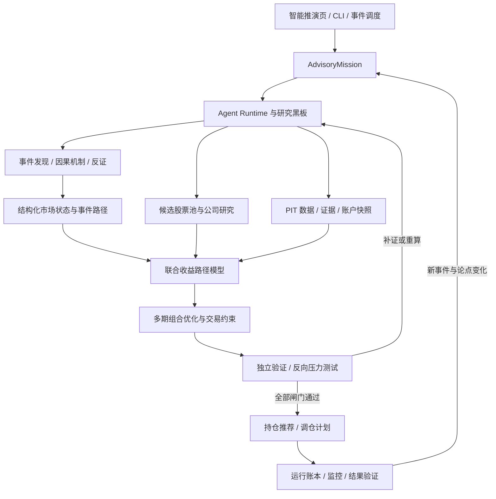

# Quant-Finance：Agent 智能投顾与事件推演总纲 V4

> 更新日期：2026-09-09。代码核对基线：`4adfd6f`。
>
> 产品目标：以「智能推演」为主工作区，自动研究当前持仓与潜在投资标的，推演未来事件如何影响公司、行业和市场，生成有证据、有量化依据、满足真实交易约束的持仓推荐与调仓方案，并持续跟踪验证。
>
> 本文是目标架构与实施总纲，不代表目标能力已经实现。第 2 节记录代码现状，其他章节为建设要求。本轮仅修改文档，未执行行情采集、模型训练、付费调用或交易。

## 1. 核心决策

采用 **多 Agent 主动研究 + 事件驱动的结构化市场状态模型 + 联合收益路径模拟 + 多期稳健组合优化 + 持续验证**。

Agent 是研究控制核心，可复现的统计模型与优化器是数值核心。二者通过明确的工具协议反复交互。系统必须回答：

1. **持有什么**：发现值得持有的新股票，解释基本面、估值、事件催化及其对当前组合的增量价值。
2. **如何调整**：逐只给出持有、增持、减持、退出、替换或观察的依据，以及目标数量、现金变化、交易成本和生效条件。
3. **未来可能怎样变化**：从真实事件出发，推演后续反应、传导、反馈和反证，计算不同未来路径下的组合风险收益。
4. **何时改变判断**：把投资论点转成可观察条件，事件更新后重算相关研究，持续检验原建议。

### 1.1 “就要最好的”如何落实

采用一套完整生产架构，按依赖分阶段交付，不为核心研究另建简化版。自治研究、PIT 数据、联合风险、候选股推荐、交易约束、校准和回放都是正式发布要求。

- 保留现有严格计算内核，禁止自动回到 V2 规则沙盘、固定宏观冲击、关键词收益映射或启发式权重。
- 核心数据、模型或求解结果不达标时，自动补证、修复、重算；仍不达标则停止发布新的投资建议。失败不能包装成“保守建议”，也不能自动解释为“继续持有”。
- 容错只允许同等质量契约下的重试、恢复与已对账来源切换，不降低 PIT、校准、完整性或求解标准。
- 高质量不等于无限 Agent、无限分支或堆叠模型。按决策价值分配计算量，保留尾部风险覆盖；不能因预算耗尽跳过关键审查。
- 本系统交付研究、组合建议及可执行格式的调仓计划。真实订单执行是独立边界，不在本次总纲中扩展。

## 2. 当前代码基线

### 2.1 已有能力与真实边界

| 领域 | 已核对实现 | 现状及下一步 |
|---|---|---|
| 生产入口 | `scenario_engine/__init__.py`、`strict_engine.py` | 默认导出严格 `ScenarioEngine`；V2 为显式 `LegacyScenarioEngine`，继续隔离 |
| 任务编排 | `mission/controller.py` | 已有状态、数据校验、特征、量化、分支、优化和原子提交；主要是固定 Python 调用，不是自治 LLM 工具循环 |
| PIT 与选源 | `data/contracts.py`、`point_in_time.py`、`router.py`、各 Adapter | 已有工件版本、时间边界、能力探测和显式路由；重点是扩大真实数据覆盖 |
| 账户持仓 | `src/stock_app/v3_portfolio.py`、`mission/sqlite_portfolio.py`、`holdings_import.py` | 已有当前账户快照、行情溯源和持仓导入；继续深化现金、可卖数量与交易时点对账 |
| 数据准备 | `scenario_data_prep.py`、`scenario_public_data.py`、`scenario_local_features.py` | 已有行情、财务、行业、新闻、资金准备；公共文本情绪仍有词典规则，默认假设为固定确认/失效分支 |
| 事件与假设 | `events/ledger.py`、`contracts.py`、`branch_planner.py` | 已分离事实与假设，支持一、二层结构化分支；不是旧文所说“全部 depth=1” |
| 特征链 | `signals/*`、`quant/impact_model.py` | 已构造财务、行业、情绪和状态快照；Adapter 调用未显式接收完整 FeatureSnapshot，不能据此宣称各类特征均影响预测 |
| 条件分布 | `quant/event_study.py`、`analog_model.py`、`factor_model.py` | 已有真实样本、状态距离、因子残差、模型注册与分位数输出；仍以资产边际分布为主 |
| 校准 | `scenario_calibration.py`、`scenario_historical_events.py`、`quant/model_registry.py` | 已有成熟事件导入、按事件时间留出和激活闸门；仍需生产算法全链回放、滚动校准及联合尾部检验 |
| 组合优化 | `portfolio_policy/optimizer.py` | 已有 SciPy MILP/HiGHS、整数交易单位、约束与最优状态校验，不能再写成“三套规则权重” |
| 页面与可靠性 | `visualization/scenario_page.py`、`components/agent_progress.py`、`ledger/*` | 已有严格页面、后台任务、事件进度、租约恢复和原子运行包，不能再写成“不持久化、进度纯占位” |
| CLI 与旧实验 | `src/stock_app/cli.py`、`Agents_Experience/*` | CLI 已有准备、诊断、校准工具；旧交易 Agent 可借鉴工具调用，不能作为生产投研能力证明 |

以上为源码与测试用例检查，不等于当前账号数据完整、外部端点可用或已有线上投资表现。

### 2.2 必须解决的核心差距

**A. Agent 控制面尚未成立。** 严格引擎拒绝 LLM runtime；页面可单独调用 LLM 解析，但任务执行使用 `use_llm=False`。控制器中的 `data_steward`、`event_scout` 等名称主要标识执行阶段。应在严格计算内核外建立真实 Agent Runtime，通过工具调用内核，不削弱数值边界。

**B. 新股票推荐尚未形成主链。** 快照、约束与量化主要围绕 `portfolio.symbols`，优化器以 `current_weights` 的键为资产集合。必须引入 `InvestmentUniverse`，对“现有持仓 ∪ 合格候选股 ∪ 现金”共同优化；新股初始数量和权重为零。

**C. 当前风险表面不等同于联合分布。** `_scenario_surface()` 提取各资产 q10，按分支和期限形成损失行。这可比较压力，但各股票同时处于自身 q10 的概率未知，不能直接解释为真实组合 CVaR；不同期限也不是同一随机变量的可交换样本。

**D. 收益口径和路径风险需统一。** `impact_model.py` 用 `exp(return)` 派生价格，输出采用对数收益；优化器直接线性加权。组合 P&L 应先转换简单收益，或按价格、股数和现金计算。`max_drawdown` 应由财富路径峰谷回撤衡量，不能用终点最差损失替代。

**E. 校准必须运行实际生产算法。** 当前校准用训练收益的经验 q10/q90 检验时间留出集，不等于逐折运行状态近邻选择与模型融合。`cvar_exceedance_rate` 实际统计低于 q10 的比例，属于 VaR 覆盖信息，不能单独证明 ES/CVaR 严重程度准确。`coverage=1.0` 也需区分输入完整性与预测覆盖率。

**F. 递归必须继承完整父路径。** 分支规划支持二层，但控制器将每个分支与根状态合并。需折叠全部祖先变化，处理覆盖、叠加、衰减及冲突，防止丢失父分支冲击。相同状态但触发时点、持续期或历史路径不同，不应粗略去重。

**G. 事件发现需从单根扩展到事件簇。** 当前根事件选择从已入账且涉及持仓的事件中取一个。目标系统须处理同时发生的政策、业绩、产业链与资金事件，识别相互作用、重复计价及候选股相关事件。

### 2.3 已有测试是回归基础

`tests/test_quant_finance_v3.py` 包含未来工件拒绝、来源对账、二层分支、整数最优解、非最优拒绝、真实进度、运行包及队列恢复测试；`test_scenario_historical_calibration.py` 覆盖历史事件与校准门槛。继续保留。合成 fixture 跑通只证明工程契约，不能证明真实市场有效性；本轮未将测试代码存在表述为测试已运行通过。

## 3. 产品交互与交付物

智能推演页提供 **诊断我的持仓、寻找值得持有的股票、生成并持续跟踪调仓方案** 三类任务，共享账户、证据、事件图、模型与决策记录。

用户一次性设定投资期限、允许市场、风险承受、现金需求和禁止交易项。系统自动准备数据与研究，每日收盘形成全量研究，重要事件触发增量重算。普通用户不选择数据源、Agent 数量、模型或分支。

| 输出 | 必须呈现 |
|---|---|
| 推荐持仓 | 推荐原因、基本面与估值、催化、预期持有期、风险重叠及边际组合价值 |
| 逐股处置 | 当前/目标数量与权重、交易数量、现金与成本影响、生效窗口、失效条件 |
| 组合对比 | 当前组合、不交易与目标组合在同一路径集下的收益区间、ES、回撤、集中度和流动性 |
| 未来事件 | 已发生事实、待观察事件、假设分支、传导链；概率与假设优先级分开 |
| 条件调仓 | 哪个信号确认后才增仓、哪个反证出现后需减仓；未来条件不能提前执行 |
| 研究状态 | 当前任务、证据冲突、完成情况、是否具备发布建议条件 |

默认给出一份主推荐及有实质差异的备选，不机械输出三套文案。不交易必须参与比较；如果违反已有硬约束，明确标识为不合格方案。展示风险条件，不作收益承诺。

## 4. 目标架构与技术取舍



### 4.1 生产技术路线

- **编排**：采用 LangGraph 构建显式状态图、专业 Agent 子图和持久化检查点。业务事实仍以 Run Ledger 与不可变工件为准；框架检查点不自动保证本项目跨工具事务一致性。[LangGraph Persistence](https://docs.langchain.com/oss/python/langgraph/persistence)
- **Agent 模型**：研究总控、推演与反证使用通过项目评测的高能力推理模型，要求工具调用、严格结构化输出及充分上下文。版本锁定至 `AgentModelPolicy`，关键角色不自动切换较弱模型。同模型多角色不视为统计独立专家。
- **状态与数据**：生产使用 PostgreSQL 保存任务、事件、账户及版本元数据；不可变原文与 Parquet 路径样本进入对象存储，DuckDB 承担批量研究查询。SQLite 保留为迁移来源和本地契约测试环境，不是另一套低标准生产链。
- **检索**：全文、向量与带时间的关系查询结合，先过滤实体、许可和 as_of，再排序。图谱从版本化关系表开始，无需先部署独立图数据库。
- **计算**：深化既有 NumPy/pandas/scikit-learn 能力，建立独立量化工具边界；采样固定随机种子，训练、在线推演、优化分别版本化。
- **优化**：保留 MILP 建模基础，多期生产模型选用经部署验证的 Gurobi，授权与资源为生产前提。可通过 CVXPY 或原生接口表达；框架支持求解器不代表特定模型已验证可解。[CVXPY 求解器文档](https://www.cvxpy.org/tutorial/solvers/index.html)
- **页面**：继续使用 Streamlit 和已有进度组件，先完成研究、组合与事件交互；更换前端不是核心质量前提。

这些是本项目的目标选择，不是外部工具对投资效果的保证。实施时锁定集成验证后的依赖、资源预算与授权，不在总纲中猜测固定模型排名或服务价格。

### 4.2 控制与计算边界

新增 `AdvisoryMissionController` 承担 Agent 研究循环；现有 `ScenarioEngine` 演进为严格计算 Facade，接受验证过的快照、路径、候选池与模型版本。

Agent 可选已批准模型、提出实验、补证及重算，不能改写事实、校准结果、风险阈值或求解输出。工具返回结构化结果、输入哈希、版本与错误码。LLM 可以提出待估参数和假设冲击，但必须标记假设，经单位与范围校验；正式概率、收益、价格区间及财务值只能来自可溯源数据或计算。

## 5. 真正的多 Agent 研究协议

### 5.1 角色与交付物

| Agent | 实际职责 | 结构化结果 |
|---|---|---|
| 研究总控 | 分解目标、发现缺口、分配任务、决定后续研究 | ResearchPlan、依赖图、停止条件 |
| 数据与证据 | 查询、原文定位、时间对齐、冲突对账 | EvidenceBundle、缺口与对账结果 |
| 事件与宏观 | 发现政策、行业、公司催化，建立事件簇 | EventCluster、事件日历 |
| 公司与产业链 | 财报质量、现金流、估值、业务和供应链暴露 | CompanyThesis、参数证据 |
| 预期与资金 | 情绪、分歧、拥挤、事件是否已被价格反映 | ExpectationState、意外程度特征 |
| 未来推演 | 后续事件、主体反应、传导与反馈 | HypothesisPath、触发与失效条件 |
| 量化研究 | 模型适用性、模拟、敏感性分析 | QuantRunRequest、误差报告 |
| 组合决策 | 请求优化、比较边际价值、条件调仓 | PortfolioProposal、替换理由 |
| 独立反证 | 在综合结论形成前独立检查关键证据与替代解释 | CriticFinding、修复任务、发布判定 |
| 跟踪复盘 | 跟踪论点、匹配真实事件、记录结果 | ThesisUpdate、OutcomeRecord |

这是角色边界，不要求每次启动固定数量进程。专业研究可并行，有依赖的计算、优化与发布顺序执行。

### 5.2 自治循环

```text
读取目标和已验证上下文
→ 提出问题与预期产物
→ 选择允许工具并执行
→ 检查来源、时间、实体和完整性
→ 提交验证器，更新研究黑板
→ 根据反证、缺口或组合敏感性重规划
→ 调用严格量化、优化及复测
→ 全部闸门通过后提交报告与监控任务
```

工具覆盖 `search_evidence`、`fetch_document`、`query_pit_data`、`build_universe`、`estimate_exposure`、`simulate_paths`、`optimize_portfolio`、`validate_proposal`、`register_monitor`，调用均携带 run/task/as_of/版本/输入哈希/幂等键。

专业 Agent 共享不可变事实引用，拥有独立工作上下文；先独立分析再对齐差异。争议靠证据、模型误差与约束解决，不能投票生成概率。只保存可核验理由、工具轨迹和修复动作，不保存或展示隐藏思维链。

网页、公告和 MCP 内容是待分析数据，无权修改任务规则。凭证留在服务端，模型不得获得任意 SQL 写入、Shell 或真实交易权限。

### 5.3 计算预算与停止条件

优先研究“对仓位影响大且证据不足”的问题，估计新增信息能否改变推荐、降低关键不确定性或解决风险边界。为尾部事件和逆向证据预留预算，避免仅优化热门路径。

停止须满足关键问题已回答、硬闸门通过、主推荐在合理扰动下稳定。仅因预算耗尽停止则标记未完成，保留研究，不发布未经验证的调仓方案。预算、分支扩展和停止规则均入账。

## 6. 数据方案与 Sequoia-X 的吸收方式

### 6.1 数据职责

| 数据域 | 主来源与职责 | 验收要求 |
|---|---|---|
| 证券主数据、日历 | 结构化授权数据，含历史上市/退市、板块和代码变更 | 任意回测日恢复当时股票池 |
| 行情、公司行动 | TuShare Pro 为结构化主来源；BaoStock 为独立核验与历史研究来源 | 原始价、复权、股数、金额、分红拆并股和时间版本一致 |
| 财务、估值、行业 | TuShare 结构化数据，原文核验关键字段 | 披露/修订时间、会计口径、行业生效期、货币单位可追溯 |
| 公告、政策、事件 | 巨潮、交易所、政府原始发布，授权新闻扩展 | 原文定位、发布时间、抓取时间、去重与更正 |
| 情绪、热度、资金 | 已验证结构化流向与 AKShare 公共信息采集 | 区分情绪、注意力、成交分类和真实持仓 |
| 账户、交易约束 | 当前账户与版本化交易规则 | 现金、持仓、可卖数量、权限、价格限制和费用生效日 |

TuShare 官方目录覆盖行情、财务、行业、资金和语料等领域；AKShare 文档提供多类公开股票数据接口。目录存在不意味着当前凭证、历史版本与使用范围已经合格，必须通过能力探测和字段核验。[TuShare 数据目录](https://tushare.pro/document/2) · [AKShare 股票数据](https://akshare.akfamily.xyz/data/stock/stock.html)

### 6.2 参考仓库核对结论

Sequoia-X 当前展示的是 A 股技术选股系统，采用 BaoStock 日 K、SQLite、增量同步与独立策略接口，适合参考采集及初筛工程；不承担完整财务证据、事件推演和组合投顾职责。[Sequoia-X README](https://github.com/sngyai/Sequoia-X)

源码采用后复权查询；增量写入按日期删除后追加批次，部分股票采集成功时可能影响该日其他股票记录。代码转换使用简单前缀规则，不能直接泛化到更广市场。[数据引擎源码](https://github.com/sngyai/Sequoia-X/blob/master/sequoia_x/data/engine.py)

策略基类返回股票代码列表；StockM1 将这类结果升级为带时间、特征和来源的候选记录，再进入公司研究及联合优化。[策略接口源码](https://github.com/sngyai/Sequoia-X/blob/master/sequoia_x/strategy/base.py)

具体吸收：

- 新增 `BaoStockAdapter`，所有输出通过 MarketArtifact 契约；不直接读取其 SQLite 表当 PIT 事实。
- 引入趋势、相对强度和量价形态作为候选发现特征，不能直接当买入指令。
- 使用证券/日期/来源/版本级幂等写入、交易日水位、失败任务账本及分片对账，避免日期级覆盖。
- 代码许可和底层数据许可分别核验；不继承“无限调用”、运行速度或收益效果等宣传结论。

### 6.3 PIT：区分事实可得与系统实际知道

保留 event_time、published_at、known_at、ingested_at、revision_id、source_uri、payload_hash，明确 valid_from/valid_to、发布时间精度、数据延迟、许可与归档证明。

- **真实系统回放**：known_at 不晚于 as_of，今天抓到的旧新闻不能进入昨天实际运行。
- **历史研究重建**：有原始发布及版本归档证明时，另记 available_at 与重建依据；不能改写原系统 known_at。无归档证明不声称当时可得。
- **训练标签**：未来收益仅在窗口结束后成为标签，记录 label_available_at；不得进入事件发生时特征、Agent 上下文或当折训练。
- **复权与估值**：成交和账户估值使用原始可交易价；研究收益用明确的总回报/复权口径。不能仅凭“后复权”就断言无未来信息。

历史研究重建、真实系统回放和前瞻纸面运行分别报告，不混合计成绩。

## 7. 从未来事件到可计算市场路径

### 7.1 市场状态与传导机制

MarketState 包括宏观政策、产业供需、公司经营、估值预期、风险偏好、资金拥挤、流动性和账户状态。每个变量标记事实、模型推导或假设，列出来源、单位、有效时间及误差。

传导分三层：事实层回答发布了什么、何时可得；机制层解释订单、收入、成本、融资和折现率如何变化；定价层估计已计价程度与新增意外对收益、波动、相关性和流动性的影响。

Agent 提出机制与待估参数，模型估计幅度、时滞和误差。观察关联不能直接升级为因果边；没有识别依据的机制保留为假设。

### 7.2 多 Agent 推演主体反应

根据任务引入政策制定者、企业经营者、上下游企业、机构配置者、杠杆资金等主体角色。各角色在自己的信息集、目标与行动约束下提出可能反应，经状态转移器验证后更新市场状态，再触发下一轮反应。

例如：已证实供给扰动 → 原料成本变化 → 企业转嫁成本或压缩利润 → 下游订单调整 → 盈利预期修正 → 资金再配置。每一步都需作用对象、时滞、触发条件、可反驳证据及参数来源；不能让主体 Agent 凭空生成股价。

LLM 主体推演发现漏掉的反应和压力路径，正式数值转移由校准模型执行。未经验证的行为假设可进入压力集合，不能冒充模拟出的真实发生频率。

### 7.3 结构化路径与自适应搜索

HypothesisPath 必含：

```text
path_id / parent_path_id / event_cluster_id
information_set_ref / evidence_refs / generation_policy_version
state_before_ref / state_delta / transition_operator
event_time_window / effect_lag / effect_duration
trigger_conditions / invalidation_conditions
probability_status / probability_model_ref
mechanism_refs / uncertainty_refs / model_support_status
```

状态操作明确 set/add/multiply/decay，统一单位，折叠全部祖先路径。仅改变标题、哈希或模型不消费的字段不是有效分支；允许模型得出接近零的影响，但要有敏感性与输入消费记录支持。

采用按风险贡献、仓位变化和证据价值扩展的束搜索，保留尾部预算、无新冲击路径和未展开事件的剩余概率质量。不再固定深度 2、每层 3 条；深度、并发与总样本数由预算和收敛规则控制。

### 7.4 概率与“已经计价”

事件概率与条件收益分布分别校准。事件模型采用分层风险率/竞争风险模型，估计特定时间窗内的条件转移；路径概率由条件转移及依赖结构形成，不相乘独立性未证实的边际概率。

只有互斥完备的同层分支概率才合计为一。可共同发生的事件用联合路径表达。未校准路径进入独立压力集合，不等权混入概率分布。

建立 ExpectationGap，比较事件内容与事前预期、估值、价格反应及拥挤状态。没有授权一致预期数据时，只能使用定义清楚且验证过的代理特征，不能冒称市场共识。

## 8. 联合收益路径模型

### 8.1 建模主线

采用 **事件条件化动态因子模型 + 市场状态切换 + 同步残差块采样 + 时间留出校准**。事件研究和历史类比用于估计冲击、检验方向及模型分歧；融合权重依据样本外表现，不以模型数量代替证据强度。

```text
下一期市场因子 = 状态转移(当前因子, 已知信息, 假设事件, 共同扰动)
下一期股票收益 = 因子暴露 × 因子变化 + 公司事件影响 + 联合残差
下一期账户价值 = 股数 × 可交易价格 + 现金 - 费用 + 公司行动现金流
```

同一路径、时间步的股票共享市场扰动，残差保持横截面与时间依赖。不能独立抽各股票收益后拼成联合路径。模型显式消费财务、行业、资金、情绪、事件阶段及意外程度，每组特征须有消融检验与适用范围。

Agent 可发起模型实验，实验在独立研究空间通过冻结评价后才发布。线上任务不能为迎合结论调整生产参数。

### 8.2 JointScenarioPaths 取代单一损失矩阵输入

```text
scenario_set_id / snapshot_id / universe_id / model_version
sample_id / event_path_id / timestamp / asset_id
raw_price / simple_return / tradable_state / liquidity_state
sample_weight / probability_status / random_seed
parameter_draw_id / source_refs / return_convention
```

sample_id 连接同一市场实现的全部资产与时点；模型选择、参数和残差采样可复现。LossCube 保留为报告投影与兼容输出，不再是唯一优化输入。

区分随机市场波动、事件不确定性、参数/模型不确定性。data_coverage、interval_coverage_oos、model_disagreement 分字段存储，禁止一个 coverage 同时表示完整性和预测可信度。

## 9. 股票推荐与多期调仓

### 9.1 全市场发现，按组合价值推荐

重建时点可投资池，按基本面质量、估值、催化、趋势、流动性和风险互补性筛选研究对象。技术形态只提供线索；正式入选必须有投资论点、事件路径、完整数据和交易约束。

保存当时股票池、筛选特征、版本、排名及排除原因。为事件受益方、行业替代标的和逆向证据预留覆盖，避免只研究上涨热门股。

候选股按加入当前组合后的边际效用排序，而非单股分数。剔除不合格候选不等于遗漏现有持仓；当前持仓即使异常也必须保留风险，并阻止基于不完整组合发布建议。

### 9.2 多期稳健优化

在校准联合路径与独立压力集合上求解分布稳健、多阶段组合模型。目标为扣成本期末效用，兼顾 ES、回撤、集中度、换手、流动性和模型敏感性。

```text
最大化：最不利可信概率分布下的预期净效用
        - 尾部风险惩罚 - 路径回撤惩罚 - 模型敏感性惩罚
约束：逐期现金守恒、整数数量、可卖数量、集中度、流动性、风险预算
```

概率不确定集合由样本外误差确定并版本化；未校准压力路径单独施加限制。各期限分别统计，通过财富路径联系，不能将 1 日和 60 日损失视为等权样本。

多阶段模型必须满足 **非预见性**：观察历史相同的路径具有相同当期决策，只有未来信号实际出现后才能采取不同动作。采用滚动重算，每次仅发布当期动作及未来条件计划，不能利用模拟未来提前交易。

现有优化目标偏重风险、换手和不确定性，缺少明确收益效用，可能偏向现金。V4 加入验证过的收益分布与用户目标，允许合理持有现金，同时解释不持有股票的机会成本。

### 9.3 交易约束与求解标准

规则按市场、板块、证券类型和生效日配置，包括申报单位、零股、可卖数量、交收、停复牌、价格限制、费用、冲击和参与率；本文定义数据契约，不硬编码可能变化的法规与费率。

以现金与股数为主变量，成本进入逐期现金守恒，不只在报告末尾扣费。要求求解器在声明容差内证明最优，记录 gap、界限、容差与耗时；不声称现实金融世界的绝对最优。

无解输出冲突与最小约束放宽诊断，Agent 不得修改用户硬约束。超时保留记录，不用未达标候选解冒充正式方案。

### 9.4 独立复测与反向压力

候选方案在相同冻结路径集公平比较，并在未参与优化的验证路径上复测。验证器独立重算股数、现金、成本、风险与约束，不直接相信优化器字段。

反向压力搜索哪些最小状态变化会突破预算、推翻投资论点或使替换失去价值，转成补证任务与监控条件。每个敏感性解释必须对应输入变化与重算结果。

## 10. 契约、账本与可靠性

以下为目标 API 示意，不是当前已可调用接口：

```python
mission = AdvisoryMission(
    objective="推荐未来三个月适合持有的股票，并优化现有持仓",
    portfolio_ref="current",
    as_of=timezone_aware_timestamp,
    investment_policy_ref="personal-policy:v4",
    universe_policy_ref="a-share-universe:v1",
)
result = advisory_controller.execute(mission)
```

| 契约 | 关键约束 |
|---|---|
| InvestmentPolicy | 期限、现金需求、效用、允许市场与不可修改的硬约束 |
| InvestmentUniverse | 当时证券集合、存续区间、筛选版本、持仓/候选标识 |
| ResearchTask / AgentArtifact | 依赖、工具、证据、验证状态、重试与成本 |
| CompanyThesis | 论点、反证、估值假设、证据、有效期和触发条件 |
| MarketState / HypothesisPath | 完整父路径、时间、转移、机制及适用范围 |
| JointScenarioPaths | 资产与时间对齐的样本、价格口径、权重与随机种子 |
| RebalancePlan | 账户快照、交易数量、现金、成本、条件、求解与复测 |
| OutcomeRecord | 事前信息集、实际事件/收益、是否执行、归因与误差 |

新增 research_tasks、agent_artifacts、investment_universes、company_theses、market_states、path_manifests、rebalance_plans、forecast_outcomes；迁移并沿用现有工件、事件、模型、进度及运行账本。

大型路径文件先写不可变对象并校验哈希，再以数据库事务提交 manifest、报告及监控 outbox。Worker 使用租约与幂等；恢复允许重放，依靠业务幂等防重复，不宣称天然 exactly-once。正式报告未提交前进度不得达到 100%。

## 11. 持续跟踪与自我改进

监控公告、财报、风险阈值、论点触发、模型漂移及账户变更。按事件簇合并转载、去抖和冷却，避免每条新闻启动全量研究；重要风险不被普通冷却规则抑制。

沿证据—事件—公司—模型—组合依赖图定位失效部分，增量重算。旧报告保留有效截止时间与失效理由，新报告解释观点变化。

记忆保存验证过的事实、研究结论、反证、适用范围与结果；过期论点失效，假设不能因反复引用成为事实。未执行建议只记纸面组合结果，不冒充真实收益。

模型、提示词和 Agent 策略按已发布版本/候选版本评测。新增模型或因子通过统一闸门后发布，Agent 不得降低门槛使自身实验通过。

## 12. 评价与发布闸门

### 12.1 时间一致评价

滚动训练、校准与测试；重叠标签窗口做 purge/embargo，同源事件簇分组。训练、阈值选择、融合权重与最终评价隔离；反复用测试集选方案后不能再称最终测试。

现代 LLM 可能记住历史事件后果，仅限制检索时间不够。历史 Agent 评测标记预训练污染风险，辅以实体/日期遮蔽诊断；价值证明必须包含事前冻结预测、按真实到达时间记录的前瞻纸面运行，不能以历史叙事重建证明预测能力。

### 12.2 指标与强基线

| 层级 | 必测内容 |
|---|---|
| 数据 | PIT 违规、修订一致、实体/单位正确、关键覆盖、延迟和冲突 |
| Agent | 证据支持、无依据结论、工具完成、恢复、无效循环、有效决策成本 |
| 事件 | 匹配精确率/召回、提前量、Brier/log loss、分时间窗可靠性 |
| 分布 | 分位数损失、CRPS、覆盖与宽度、VaR 覆盖/独立性、ES 严重程度与联合风险 |
| 组合 | 扣成本收益、ES、路径回撤、换手、现金与约束违规、稳定性和容量 |
| 增量价值 | 对不调仓、行业约束组合、同数据非 Agent 模型及无事件/情绪/图谱消融进行比较 |

置信区间按事件簇与时间块估计，同一事件下多股票和多期限不能当完全独立样本。经济价值按预注册用户效用衡量，不要求所有收益风险指标同时改善，也不预设多 Agent 必然胜出。

### 12.3 发布要求

- PIT、事实/假设隔离、现金守恒、交易硬约束违规数为零。
- Agent 有真实动态调用、验证与修复轨迹，不能用阶段日志冒充自治。
- 概率、区间、联合风险达到预注册阈值；样本不足或置信区间过宽不得正式推荐。
- 对强基线的净效用增量须有样本外及前瞻证据，披露分市场状态结果。
- 主推荐通过独立复测、反向压力、审计与恢复演练。
- 最小独立事件数、前瞻观察期、功效分析与阈值在看最终结果前冻结；当前 min_samples=20 不是充分性证明。

## 13. 文件级实施路线

这是同一完整方案的依赖顺序。阶段成果可单独验收，全部发布闸门满足前不包装成完成的智能投顾。

| 阶段 | 主要文件 | 交付与验收 |
|---|---|---|
| P0 数值与递归正确性 | quant/contracts.py、impact_model.py、portfolio_policy/optimizer.py、mission/controller.py、scenario_calibration.py | 统一收益/现金流，区分压力与联合风险，完整父路径继承，校准运行生产算法，保留 V3 回归 |
| P1 完整数据与候选池 | data/*，新增 data/baostock_adapter.py、universe/*；深化 scenario_data_prep.py、scenario_public_data.py、v3_portfolio.py | 可恢复 PIT 全市场池，持仓候选同标准，部分采集失败不破坏其他证券，新股零数量进入约束 |
| P2 自治研究控制面 | 新增 agents/runtime.py、roles.py、tools.py、research_board.py、mission/advisory_controller.py；深化 strict_engine.py | 自动选工具、补证、重规划、独立反证与恢复，固定假设退出正式主链 |
| P3 事件状态与联合模型 | 深化 events/*、signals/*、quant/*；新增 world_state/*、quant/joint_paths.py、calibration/walk_forward.py | 多事件簇、传导、条件概率、共同扰动、特征消费，相关性与尾部测试 |
| P4 多期持仓决策 | portfolio_policy/*；新增 multi_period.py、execution_constraints.py、proposal_validator.py | 现有/新股联合优化、非预见性、成本现金流、独立复测、交易数量与无解诊断 |
| P5 产品与前瞻验证 | visualization/scenario_page.py、components/agent_progress.py、src/stock_app/cli.py、ledger/*；新增 evaluation/* | 一键研究、主推荐与条件计划、真实进度、事件监控、前瞻记录及发布闸门 |

表中 data、agents、mission、events、signals、quant、world_state、calibration、portfolio_policy、ledger、evaluation、universe 均相对 `scenario_engine/`；scenario_*.py 与 v3_portfolio.py 相对 `src/stock_app/`；components 相对 `visualization/`。标注新增的路径尚待实现。

部署时集中配置凭证，单次研究不要求用户反复准备每个数据域。`scenario-doctor` 扩展为账号覆盖、版本、模型、求解器与缺口诊断，诊断通过不等于投资有效。

迁移采用影子运行与显式版本切换，在同快照对比 V3/V4，保留旧报告可读性。版本切换不是任务失败后的自动降级。SQLite 到 PostgreSQL 核对行数、哈希、时间精度与关系引用，设定唯一写入方和明确切换点。

## 14. 关键验收场景

1. 少量现有持仓之外能发现新股票，以零初始数量进入优化，并解释替换价值。
2. 多源转载合成一个事实事件簇，历史更正版本按时点正确回放。
3. 二层利润冲击保留父路径利率冲击与持续期，路径冲突可检测。
4. 两组股票边际分布相同但相关性不同，组合 ES 和仓位相应变化。
5. 路径先大跌后恢复，即使终点收益良好也能识别中途回撤违规。
6. 对数收益、分红、费用、整数交易及现金守恒经独立验证。
7. 同信息历史的路径具有相同今日交易，信号出现后才分化条件计划。
8. 关键资料缺失、冲突或模型不支持时自动补证，不能解决则停止发布，不填零或回到模板。
9. Worker 在工具执行、检查点或报告提交边界崩溃，恢复不重复写事实或发布监控。
10. 无事件、约束无解、求解超时、样本不足和历史重建有准确状态，不显示为成功推荐。
11. 反证推翻论点时更新建议，保留旧观点与变更原因，不重写历史制造正确记录。
12. 冻结的样本外及前瞻评价明确多 Agent 相对同数据基线改善了什么；未证明价值则继续研究，不降低闸门。

## 15. 完成定义

用户在智能推演中提交持仓与目标后，系统能自主核验信息、发现新股票、推演相互作用的未来事件、形成可校准联合市场路径、求解并验证调仓计划、持续跟踪论点与实际结果。每条建议都能追溯到当时可得证据、模型与约束。

最优先建设 **真正的 Agent 研究闭环、全市场候选推荐、联合路径与多期决策**。现有严格 PIT、真实进度、整数求解与原子账本是应继续深化的基础。
